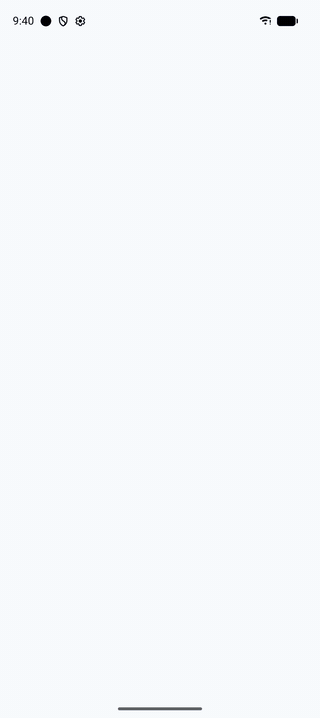

# HowYouDoin

All your chats in one inbox: WhatsApp, Messenger, Instagram, Telegram, Signal, Slack, Bluesky,
LinkedIn, Discord, X and Matrix, connected straight from your Android phone. There are no HowYouDoin servers and no account to create: your messages and logins stay on the
phone and go only to the networks themselves.

<p align="center">
  
  <br><sub>Demo mode: welcome, inbox, a chat, connecting WhatsApp and Messenger, and calls through Matrix</sub>
</p>

> **Unofficial app.** HowYouDoin is not made, endorsed or supported by Meta (WhatsApp, Messenger, Instagram),
> Telegram, Signal, Slack, Google, Bluesky, LinkedIn, Discord or X. Those services don't officially allow third-party apps and could limit or block an account
> that uses one. Use it at your own risk.

Status: experimental, Android only for now. (An iOS build exists in the code but isn't released; see below.)

## Features

- One inbox for all connected networks, with search and an unread filter
- Text, photos, videos, voice messages and files; reactions, replies, edits, deletions, typing and read receipts
  where the network supports them
- WhatsApp, Telegram and Signal link like a desktop app (QR code, pairing code or login code); Messenger, Instagram, Slack, LinkedIn, Discord and X log in through their websites inside the
  app; Bluesky with an app password
- Bluesky, LinkedIn, Discord and X are new; Bluesky, LinkedIn and X have been tested with real accounts, Discord
  is **untested with real accounts** so far; see
  [docs/networks.md](docs/networks.md) for what each one can do and which networks were left out and why
- New messages to anyone: each network is searched by name or username (WhatsApp and Signal by phone number)
- Voice and video calls with Matrix contacts (calls on the other networks aren't supported)
- Notifications from a background connection, without push servers
- App lock with a PIN or fingerprint, hidden message text in notifications, and no screenshots while locked
- Crash reports stay on the phone; you choose whether to share them
- 12 languages, four colour themes, light and dark
- Try everything in demo mode without connecting an account
- Optional: connect through your own Matrix homeserver with mautrix bridges instead (server mode)

## Building

Requirements: JDK 17+, the Android SDK and NDK, Go (see `bridge-mobile/go.mod`) with `gomobile`/`gobind`, and for
Signal: Rust (via rustup) with the `aarch64-linux-android` target, `cargo-ndk`, `cmake` and `protoc`.

1. Check out the network clients next to this repository, in `../howyoudoin-bridges/`:
   `bridge-mobile/scripts/fetch-bridges.sh`. It fetches mautrix-meta, -telegram, -signal (with libsignal), -slack,
   -linkedin, -gvoice, -gmessages and -twitter at the versions the app uses and applies `bridge-mobile/patches/mautrix-meta.patch`.
2. Build the network clients library: `bridge-mobile/scripts/build-android.sh`. It writes
   `composeApp/libs/hydbridge.aar` and refreshes the in-app license list.
3. Optional, for Telegram: create an app at <https://my.telegram.org> and add to `local.properties`:
   ```
   telegram.apiId=…
   telegram.apiHash=…
   ```
   Without these the build works but doesn't offer Telegram.
4. Build the app: `./gradlew :composeApp:assembleDebug`.

After changing Gradle dependencies, refresh the license list with `./gradlew :composeApp:exportLibraryDefinitions`.

## Tests

- Unit tests: `./gradlew testDebugUnitTest`.
- Network client tests (Go): `bridge-mobile/scripts/test-go.sh`, against fake servers; with `HYD_LIVE=1` they also
  check that made-up logins are turned down by the real services with the right message. They need Signal's Rust
  library built for the computer once (`cargo build -p libsignal-ffi --release` in the libsignal checkout).
- End-to-end tests (`composeApp/src/androidInstrumentedTest`) walk through the app in demo mode: the welcome screen,
  a chat, every screen Settings and About lead to, the themes, the warning before connecting a network, and the welcome
  screen in each language. They clear the app's data, so run them on an emulator only:
  `ANDROID_SERIAL=emulator-5554 ./gradlew :composeApp:connectedDebugAndroidTest`.
- GitHub Actions (`.github/workflows/android.yml`) builds the debug APK and runs the unit tests on every push and pull
  request; the APK is attached to each run.
- `docs/demo.gif` is recorded by the `DemoTour` UI test: run Actions → Demo GIF (it attaches a new GIF to the run), or
  locally on an emulator with
  `./gradlew :composeApp:connectedDebugAndroidTest -Pandroid.testInstrumentationRunnerArguments.class=com.devvalor.howyoudoing.app.e2e.DemoTour -Pandroid.testInstrumentationRunnerArguments.demoTour=true`
  and convert `/sdcard/tour.mp4` with ffmpeg. Add the `TELEGRAM_API_ID` and `TELEGRAM_API_HASH` repository secrets to
  include Telegram.

## Translations

The app is in English, Polish, Spanish, Portuguese, Russian, German, French, Indonesian, Turkish, Japanese, Hindi and
Arabic. Texts live in each module's `composeResources/values/strings.xml` (Android-only ones, such as notifications, in
`composeApp/src/androidMain/res/values/strings.xml`), with one `values-xx` folder per language. Indonesian is in both
`values-in` (what Android reports) and `values-id` (iOS). On Android 13+ the language can be picked per app in the
phone's settings. The translated terms of use say that the English version applies if they differ.

## Privacy

See [docs/privacy-policy.md](docs/privacy-policy.md). In short: no analytics, no servers of ours in the default
mode, nothing leaves the phone except to the networks you connect.

## Terms of use and disclaimer

HowYouDoin is unofficial and provided "as is", without warranty. Most of the networks don't allow third-party
apps and may limit or ban accounts that use one; you use it at your own risk. See
[docs/terms-of-use.md](docs/terms-of-use.md) (also in the app under Settings → Terms of use).

## License

HowYouDoin is free software: you can redistribute it and/or modify it under the terms of the
[GNU Affero General Public License v3](LICENSE) as published by the Free Software Foundation.

It includes third-party code under its own licenses, listed in the app under Settings → Open-source licenses.
Notably mautrix-meta, -signal, -gmessages, -gvoice, -linkedin and -twitter and libsignal are AGPL-3.0, whatsmeow is
MPL-2.0, the Telegram MTProto library (a gotd fork) is MIT and discordgo is BSD-3-Clause. Because of the AGPL components, anyone distributing a modified version must also
offer its source code.

### iOS

The iOS app shares most of the code but isn't released: Apple's App Store terms conflict with the AGPL, and iOS
doesn't keep background connections, so it would need a server for timely notifications. Telegram and Signal
aren't wired up on iOS yet.
